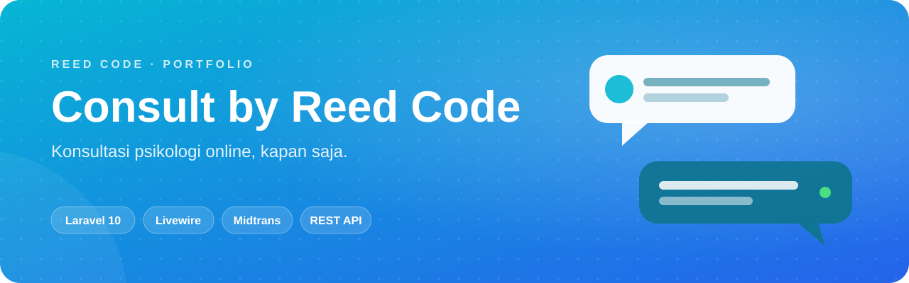
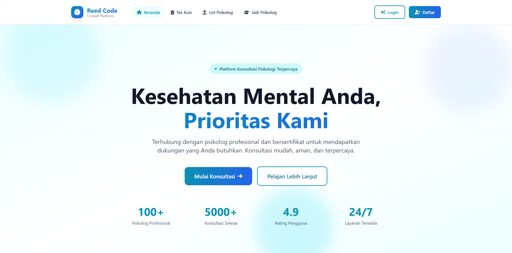
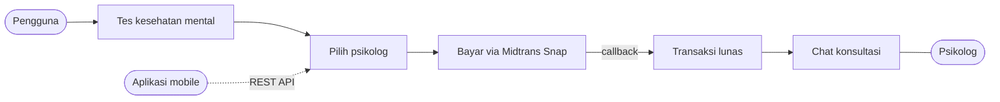

<p align="center">
  
</p>

<p align="center">
  <b>Ruang aman untuk bercerita.</b> Pengguna menemukan psikolog yang cocok, membayar sesi, lalu berkonsultasi lewat chat dari mana saja.
</p>

<p align="center">
  <a href="#sekilas">Sekilas</a> ·
  <a href="#kemampuan">Kemampuan</a> ·
  <a href="#alur-kerja">Alur Kerja</a> ·
  <a href="#mulai-menjalankan">Mulai Menjalankan</a> ·
  <a href="#akun-demo">Akun Demo</a> ·
  <a href="#rest-api">REST API</a>
</p>

<p align="center">
  
  <br>
  
  
  
</p>

## Sekilas

**Consult by Reed Code** adalah platform konsultasi psikologi online berbasis Laravel. Satu codebase melayani tiga peran: **pengguna** yang mencari bantuan, **psikolog** yang memberikan sesi, dan **admin** yang menjaga semuanya tetap berjalan. Platform ini juga menyediakan REST API yang dipakai aplikasi pendampingnya, [Consult Mobile](https://github.com/KyyStacy/psychology-consultation-flutter).

<p align="center">
  
</p>

## Kemampuan

<table>
  <tr>
    <td width="50%" valign="top">
      <b>🧩 Tes Kesehatan Mental</b><br>
      Kuis singkat untuk self-assessment, dengan hasil yang langsung mengarahkan pengguna ke konsultasi.
    </td>
    <td width="50%" valign="top">
      <b>🧑‍⚕️ Direktori Psikolog</b><br>
      Profil, bio, tarif per sesi, dan indikator online untuk setiap psikolog.
    </td>
  </tr>
  <tr>
    <td valign="top">
      <b>💳 Pembayaran Midtrans</b><br>
      Checkout dengan Midtrans Snap. Status transaksi diperbarui otomatis lewat callback.
    </td>
    <td valign="top">
      <b>💬 Chat Konsultasi</b><br>
      Ruang chat Livewire yang memperbarui pesan otomatis tanpa reload halaman.
    </td>
  </tr>
  <tr>
    <td valign="top">
      <b>🛡️ Panel Admin</b><br>
      Kelola akun admin, psikolog, dan pengguna; pantau seluruh transaksi dan status online.
    </td>
    <td valign="top">
      <b>📝 Rekrutmen Psikolog</b><br>
      Formulir "Jadi Psikolog" dengan upload CV (PDF, maks. 5 MB), email ke admin, dan email konfirmasi ke pelamar.
    </td>
  </tr>
  <tr>
    <td valign="top">
      <b>🔐 Hak Akses per Role</b><br>
      Role <code>admin</code>, <code>psikolog</code>, dan <code>user</code> dengan Spatie Laravel Permission.
    </td>
    <td valign="top">
      <b>📱 REST API Mobile</b><br>
      Auth berbasis Bearer token untuk profil, transaksi, dan chat dari aplikasi Flutter.
    </td>
  </tr>
</table>

## Alur Kerja



## Mulai Menjalankan

> Butuh **PHP 8.1+**, **Composer**, **Node.js 16+**, dan **MySQL**.

```bash
git clone https://github.com/KyyStacy/psychology-consultation-laravel.git
cd psychology-consultation-laravel

composer install && npm install
cp .env.example .env && php artisan key:generate

php artisan migrate --seed
php artisan storage:link

npm run dev            # terminal 1
php artisan serve      # terminal 2  →  http://localhost:8000
```

<details>
<summary><b>Konfigurasi <code>.env</code></b></summary>

<br>

| Kunci | Fungsi |
|---|---|
| `DB_DATABASE`, `DB_USERNAME`, `DB_PASSWORD` | Koneksi MySQL |
| `MAIL_HOST`, `MAIL_USERNAME`, `MAIL_PASSWORD` | SMTP untuk email lamaran psikolog |
| `MIDTRANS_MERCHANT_ID` | Merchant ID Midtrans |
| `MIDTRANS_SB_CLIENT_KEY`, `MIDTRANS_SB_SERVER_KEY` | Key sandbox (dipakai saat `MIDTRANS_IS_PRODUCTION=false`) |
| `MIDTRANS_CLIENT_KEY`, `MIDTRANS_SERVER_KEY` | Key production |

</details>

<details>
<summary><b>Setelah instalasi</b></summary>

<br>

- Atur **Payment Notification URL** di dashboard Midtrans ke `https://domain-kamu/midtrans/callback`.
- Ganti alamat email penerima lamaran psikolog di `app/Http/Controllers/PsychologistApplicationController.php`.

</details>

## Akun Demo

Semua akun hasil seeder memakai password `password`.

| Role | Email |
|---|---|
| Admin | `admin@reedcode.id` |
| Psikolog | `psikolog@reedcode.id` · `psikolog2@reedcode.id` · `psikolog3@reedcode.id` |
| Pengguna | `user@reedcode.id` · `user2@reedcode.id` · `user3@reedcode.id` |

## REST API

Prefix `/api`. Endpoint terproteksi memakai header `Authorization: Bearer <token>`.

| Grup | Endpoint |
|---|---|
| Auth | `POST /login` · `POST /register` · `POST /logout` |
| Profil | `GET /user` · `POST /profile/update` · `POST /profile/update-photo` · `POST /profile/change-password` · `POST /profile/delete` |
| Psikolog | `GET /psychologists` |
| Transaksi | `GET /transactions` · `POST /transaction/create` · `POST /transaction/update-status` · `POST /transaction/check-status` · `GET /transaction/midtrans-config` |
| Chat | `GET /messages/conversations/{userId}` · `GET /messages/{fromUserId}/{toUserId}` · `POST /messages` |

---

<div align="center">

<h2>Dibuat oleh Kyy Stacy × Reed Code</h2>

<p><i>Web & app developer: dari landing page sampai sistem bisnis custom.</i></p>

<a href="https://www.instagram.com/reedcode.id"></a>
<a href="https://www.tiktok.com/@reedcode.id"></a>
<a href="https://github.com/KyyStacy"></a>

<br><br>

<table>
  <tr>
    <td colspan="4" align="center"><b>Punya ide aplikasi atau butuh website untuk bisnismu?</b><br><sub>Reed Code siap bantu dari desain sampai online.</sub></td>
  </tr>
  <tr>
    <td align="center" width="25%">🌐<br><b>Company Profile</b><br><sub>Website brand & usaha</sub></td>
    <td align="center" width="25%">🛒<br><b>Toko Online</b><br><sub>Katalog & pembayaran online</sub></td>
    <td align="center" width="25%">📊<br><b>Sistem Bisnis</b><br><sub>Kasir, inventaris, booking</sub></td>
    <td align="center" width="25%">📱<br><b>Aplikasi Mobile</b><br><sub>Android & iOS</sub></td>
  </tr>
</table>

<a href="https://wa.me/6285171713355?text=Halo%20Reed%20Code%2C%20saya%20tertarik%20dengan%20jasa%20pembuatan%20website"></a>

<br><br>

<sub>© 2026 Kyy Stacy · Reed Code</sub>

</div>
